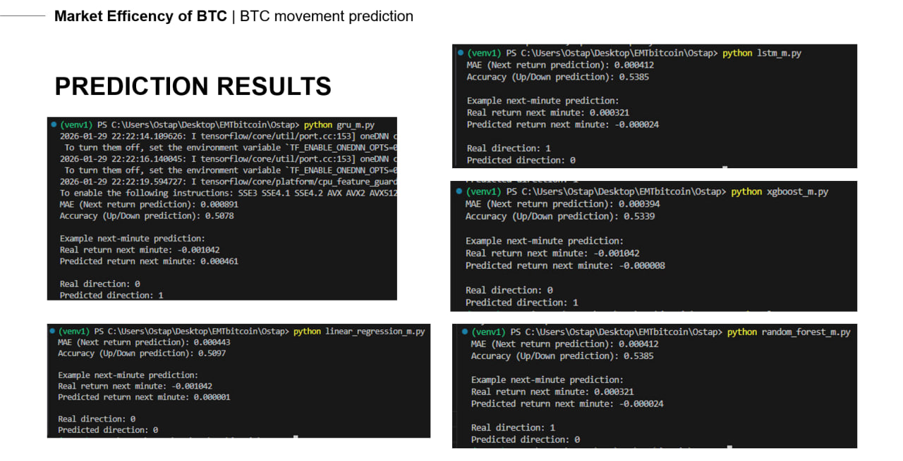
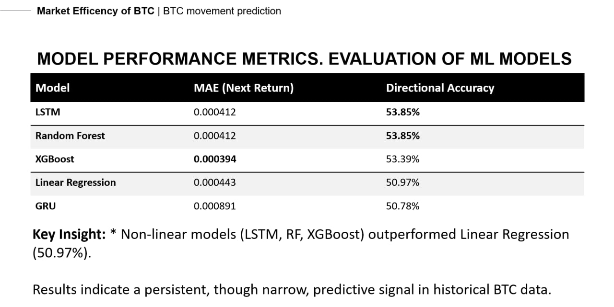
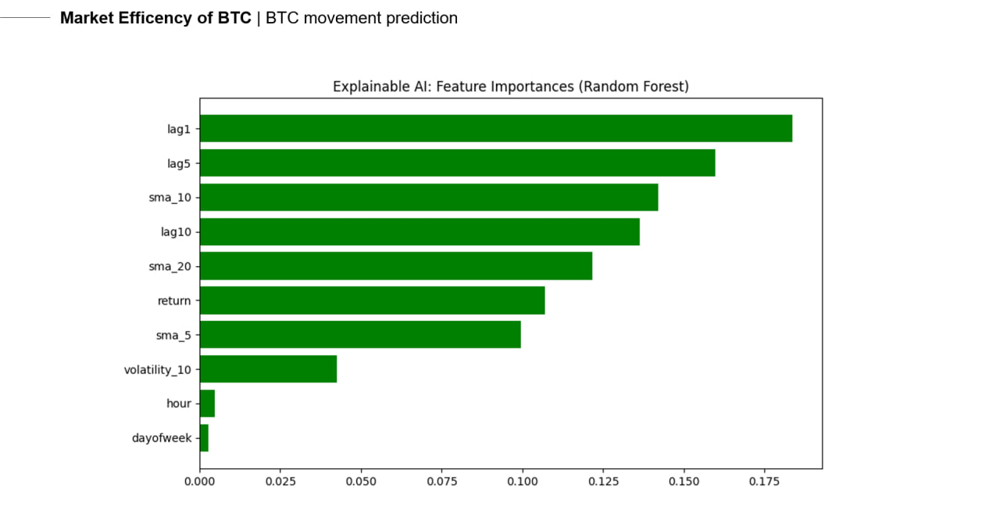
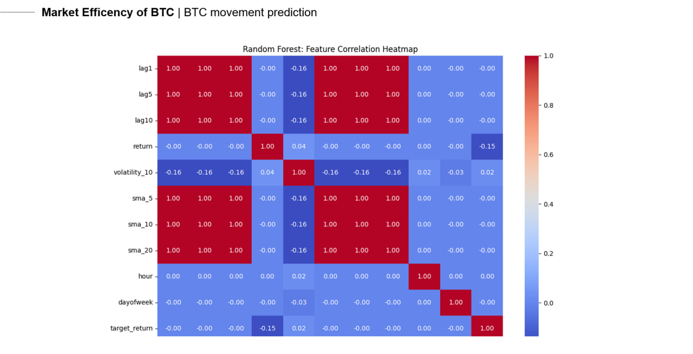

# ₿ EMTbitcoin — Bitcoin Price Movement Prediction

A collaborative machine learning research project exploring Bitcoin price movement prediction using historical market data, time-series models, and social media sentiment analysis.

The project combines traditional machine learning, deep learning, statistical analysis, and feature engineering to investigate patterns in cryptocurrency markets.

Developed by an international team of five students during an academic exchange in Germany.

---

## 🎯 Project Overview

Bitcoin markets are characterized by high volatility, complex price dynamics, and constantly changing market conditions.

The objective of EMTbitcoin is to investigate whether historical market information and social media sentiment can provide useful signals for predicting short-term Bitcoin price movements.

The project explores two complementary directions:

1. **Bitcoin Price Prediction** — Developing regression and classification models using historical market data.
2. **Sentiment Analysis** — Investigating relationships between social media sentiment and Bitcoin market behavior.

The research focuses on experimental model development, comparative evaluation, and interpretation of the results.

---

## ✨ Key Features

- Historical Bitcoin market data processing.
- Time-series feature engineering.
- Regression and classification models.
- Traditional machine learning algorithms.
- Deep learning with LSTM and GRU networks.
- Model performance comparison.
- Explainable AI and feature importance analysis.
- Exploratory data analysis and visualization.
- Social media sentiment analysis.
- Statistical evaluation of sentiment-price relationships.
- Collaborative Git-based development.

---

## 📊 Experimental Results

### 1. Model Execution & Prediction Results

Five machine learning approaches were implemented and tested using historical Bitcoin market data.

The experiments include:

- Linear and Logistic Regression.
- Random Forest.
- XGBoost.
- Long Short-Term Memory (LSTM).
- Gated Recurrent Unit (GRU).

The following screenshot shows execution results from the Python forecasting scripts, including evaluation metrics and examples of predicted versus actual market movements.



### 2. Model Performance Comparison

The models were evaluated using regression and classification metrics.

The following results were reported in the project presentation:

| Model | MAE (Next Return) | Directional Accuracy |
|---|---:|---:|
| LSTM | 0.000412 | 53.85% |
| Random Forest | 0.000412 | 53.85% |
| XGBoost | 0.000394 | 53.39% |
| Linear Regression | 0.000443 | 50.97% |
| GRU | 0.000891 | 50.78% |



**Observations:**

- LSTM and Random Forest achieved the highest reported directional accuracy of 53.85%.
- XGBoost achieved the lowest reported MAE of 0.000394.
- Linear Regression provided a useful baseline.
- GRU showed lower performance in these experiments.

These results indicate small differences between model performance on the selected historical dataset.

They should not be interpreted as proof of reliable future market prediction or trading profitability.

### 3. Explainable AI — Feature Importance

To better understand model behavior, feature importance analysis was performed.

The Random Forest implementation evaluates the relative contribution of historical market indicators.



Among the most influential features in the reported experiment were:

- Previous closing prices.
- Lagged market observations.
- Simple moving averages.
- Historical returns.

Time-related features such as hour and day of the week showed lower relative importance.

Feature importance reflects the fitted model and dataset; it does not establish causal relationships.

### 4. Feature Correlation Analysis

Exploratory data analysis was performed to investigate relationships between market features.



The heatmap visualizes relationships between:

- Lagged closing prices.
- Moving averages.
- Historical returns.
- Volatility.
- Temporal indicators.
- Next-period returns.

The strong correlations between price-based features illustrate the presence of redundant information in several historical indicators.

---

## 🛠️ Technology Stack

| Category | Technologies |
|---|---|
| Programming Language | Python |
| Data Processing | Pandas, NumPy |
| Machine Learning | Scikit-learn, XGBoost |
| Deep Learning | TensorFlow, Keras |
| Data Visualization | Matplotlib, Seaborn |
| Statistical Analysis | Statsmodels |
| Natural Language Processing | Transformer-based sentiment models |
| Development Tools | Git, GitHub, Jupyter Notebook |
| Data Formats | CSV, Parquet |

---

## 🧠 Machine Learning Models

The price prediction component implements several algorithms representing different modeling approaches.

### Linear & Logistic Regression

Baseline models used for regression and binary classification.

- Linear Regression predicts the next-period return.
- Logistic Regression predicts whether the next-period return will be positive.
- Model coefficients can be analyzed for interpretation.

### Random Forest

An ensemble learning approach based on multiple decision trees.

The implementation includes:

- Random Forest Regression.
- Random Forest Classification.
- Historical feature processing.
- Feature importance analysis.
- Model performance evaluation.

### XGBoost

A gradient boosting algorithm designed to model nonlinear relationships.

The implementation includes:

- XGBoost Regression.
- XGBoost Classification.
- Feature engineering.
- Prediction evaluation.
- Feature importance visualization.

### Long Short-Term Memory (LSTM)

A recurrent neural network architecture designed for sequential data.

The implementation uses historical observation windows to learn temporal relationships.

Features include:

- Time-series sequence generation.
- Feature normalization.
- Regression and classification networks.
- Dropout regularization.
- Performance evaluation.

### Gated Recurrent Unit (GRU)

A recurrent neural network architecture that uses gating mechanisms to process sequential information.

The GRU implementation includes:

- Historical observation windows.
- Regression and classification networks.
- Model training and evaluation.
- Permutation-based feature importance.

---

## 📈 Data Processing & Feature Engineering

Historical Bitcoin market data is transformed into features used by the prediction models.

### Engineered Features

| Feature | Description |
|---|---|
| `Close` | Bitcoin closing price |
| `return` | Percentage change in price |
| `lag1` | Previous closing price |
| `lag5` | Closing price shifted by five observations |
| `lag10` | Closing price shifted by ten observations |
| `volatility_10` | Rolling standard deviation of returns |
| `sma_5` | Five-period simple moving average |
| `sma_10` | Ten-period simple moving average |
| `sma_20` | Twenty-period simple moving average |
| `hour` | Hour of the day |
| `dayofweek` | Day of the week |

Different models use different combinations of these features.

### Prediction Targets

Two prediction tasks are implemented.

**Regression:** Predict the next-period Bitcoin return.

**Classification:** Predict whether the next-period return will be positive.

```python
df["target_return"] = df["return"].shift(-1)

df["target_up"] = (
    df["target_return"] > 0
).astype(int)
```

The experimental scripts use chronological train/test separation to preserve the ordering of historical observations.

---

## 📐 Evaluation Metrics

### Regression

| Metric | Description |
|---|---|
| MAE | Mean Absolute Error |
| R² | Coefficient of determination |

### Classification

| Metric | Description |
|---|---|
| Accuracy | Proportion of correctly classified observations |
| F1 Score | Harmonic mean of precision and recall |
| ROC-AUC | Ability to distinguish between classification classes |

The models are evaluated using historical test observations.

Additional visualizations help interpret model behavior and the relationships between input features.

---

## 💬 Sentiment Analysis Pipeline

The project also includes a separate sentiment analysis research component.

This part investigates potential relationships between social media sentiment and Bitcoin price movements.

The experimental pipeline includes:

- Twitter text preprocessing.
- Transformer-based sentiment classification.
- Sentiment score generation.
- Temporal aggregation.
- Integration with historical Bitcoin market data.
- Correlation analysis.
- Statistical significance testing.
- Exploratory strategy backtesting.

### Research Scope

The sentiment documentation describes experiments using Bitcoin-related Twitter data from 2021.

The reported research investigates relationships between public sentiment and subsequent Bitcoin returns.

Statistical techniques include:

- Pearson correlation.
- T-tests.
- Granger causality tests.
- Sentiment quantile analysis.
- Historical backtesting.

### Key Considerations

The documented experiments identified weak statistical relationships between some sentiment indicators and subsequent price movements.

However, the reported sentiment-based trading strategies did not outperform a buy-and-hold benchmark.

These findings highlight the difference between identifying historical statistical patterns and developing a reliable forecasting or trading system.

Further validation across multiple market cycles would be necessary.

---

## 👨‍💻 My Contribution

**Ostap Bednarchuk — Machine Learning & Time-Series Prediction**

My work focused on designing, implementing, and evaluating machine learning models for short-term Bitcoin price movement prediction.

### Model Development

Implemented:

- Linear Regression.
- Logistic Regression.
- Random Forest.
- XGBoost.
- LSTM.
- GRU.

### Data Processing

- Processed historical Bitcoin market data.
- Created time-series features.
- Prepared regression and classification targets.
- Applied feature scaling and sequence generation.
- Prepared chronological training and testing datasets.

### Model Evaluation

- Evaluated prediction performance using MAE, R², Accuracy, F1, and ROC-AUC.
- Compared multiple machine learning approaches.
- Analyzed feature importance.
- Generated visualizations for exploratory analysis.

**[View My Forecasting Models on GitHub](https://github.com/Ostap8943/EMTbitcoin/tree/ostap_btc_forecast/Ostap)**

---

## 🤝 Team Collaboration

EMTbitcoin was developed by an international team of five students.

The project involved collaborative work in several areas:

- Financial time-series analysis.
- Machine learning.
- Deep learning.
- Natural language processing.
- Social media sentiment analysis.
- Statistical evaluation.
- Results visualization and presentation.

The collaboration provided experience in coordinating technical work, using Git for version control, and communicating research results in an international environment.

---

## 🗂️ Repository Structure

The project contains multiple research components and development branches.

The main branch includes sentiment analysis notebooks, datasets, documentation, and presentation materials.

My forecasting implementations are available in the `ostap_btc_forecast` branch.

### Forecasting Models

```text
Ostap/
├── linear_regression_m.py
├── random_forest_m.py
├── xgboost_m.py
├── lstm_m.py
└── gru_m.py
```

| File | Purpose |
|---|---|
| `linear_regression_m.py` | Linear and Logistic Regression |
| `random_forest_m.py` | Random Forest models |
| `xgboost_m.py` | XGBoost models |
| `lstm_m.py` | LSTM neural networks |
| `gru_m.py` | GRU neural networks |

Other repository components include sentiment analysis notebooks, statistical research documents, datasets, and project presentations.

---

## 🚀 Getting Started

### Prerequisites

- Python 3.10+
- Git
- pip
- Virtual environment (recommended)

The forecasting models are research scripts rather than a packaged application.

### 1. Clone the Repository

```bash
git clone https://github.com/Ostap8943/EMTbitcoin.git
cd EMTbitcoin
```

### 2. Switch to the Forecasting Branch

```bash
git checkout ostap_btc_forecast
```

### 3. Create a Virtual Environment

**Windows:**

```bash
python -m venv .venv
.venv\Scripts\activate
```

**Linux / macOS:**

```bash
python3 -m venv .venv
source .venv/bin/activate
```

### 4. Install Dependencies

```bash
pip install pandas numpy matplotlib seaborn scikit-learn tensorflow xgboost
```

### 5. Prepare Historical Bitcoin Data

The forecasting scripts expect a CSV dataset named:

```text
btcusd_1-min_data.csv
```

The dataset should contain historical Bitcoin prices, including the columns:

- `Timestamp`
- `Close`

The timestamp is expected to be stored as Unix time in seconds.

Place the dataset in the working directory, or modify the CSV path in the model script.

The historical dataset must be supplied separately if it is not included in the checked-out branch.

### 6. Run a Model

For example:

```bash
python Ostap/random_forest_m.py
```

Other models:

```bash
python Ostap/linear_regression_m.py
python Ostap/xgboost_m.py
python Ostap/lstm_m.py
python Ostap/gru_m.py
```

The scripts train and evaluate their respective models and generate available diagnostic outputs.

Execution time depends on the model, dataset size, and available hardware.

---

## ⚠️ Limitations

The project is experimental and has several methodological limitations.

- Bitcoin markets are highly volatile.
- Historical predictive relationships may not persist.
- Model performance depends on the selected dataset.
- Classification results may be affected by class imbalance.
- Models may be sensitive to feature redundancy.
- Data leakage can lead to overly optimistic performance estimates.
- Backtesting results depend on evaluation methodology.
- Transaction costs and market execution affect real-world profitability.

### Data Leakage Consideration

Some experimental scripts fit feature scalers before separating chronological training and testing observations.

A more rigorous evaluation should fit preprocessing transformations exclusively on the training data and apply them to the test data.

The reported metrics should therefore be treated as preliminary experimental results until validated using a leakage-free evaluation pipeline.

---

## 🔮 Future Improvements

Potential improvements include:

- Unified preprocessing and evaluation pipelines.
- Leakage-free chronological validation.
- Walk-forward backtesting.
- Hyperparameter optimization.
- Cross-model performance comparison.
- Automated testing.
- Experiment tracking and reproducibility.
- Integration of sentiment features into forecasting models.
- Model deployment through a REST API.
- Interactive visualization dashboard.

---

## 📚 References

- [Scikit-learn Documentation](https://scikit-learn.org/stable/)
- [TensorFlow Documentation](https://www.tensorflow.org/)
- [XGBoost Documentation](https://xgboost.readthedocs.io/)
- [Pandas Documentation](https://pandas.pydata.org/docs/)
- [NumPy Documentation](https://numpy.org/doc/)
- [Matplotlib Documentation](https://matplotlib.org/stable/)
- [Statsmodels Documentation](https://www.statsmodels.org/stable/)

---

## 📄 Disclaimer

This project was developed for educational and research purposes.

The results are based on historical experiments and do not establish reliable future market predictions.

The project does not provide financial advice or a production-ready trading system.
